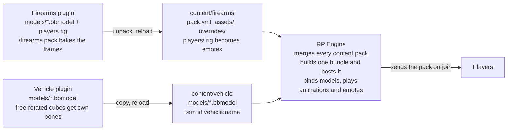

# Vehicle and RP Engine

Since 2.0 the plugin hands its car models to [RP Engine](https://hangar.papermc.io/ResourcePackAI/RPEngine), which
builds and serves the server's one resource pack. BetterModel is not used anymore.

## How the pieces fit

Each plugin only writes files into its own folder under `plugins/RPEngine/content` and asks RP Engine to reload;
at runtime the plugins also call RP Engine's API to bind a model to an entity, play an animation or start an emote.

## How a car is drawn

1. On start every `plugins/Vehicle/models/*.bbmodel` is copied to `plugins/RPEngine/content/vehicle/models/`. Before
   copying, any cube whose rotation is not a plain Java rotation (one axis, 22.5° steps within ±45°) is moved into its
   own bone: a bone rotation is exact, a free cube rotation may be approximated. RP Engine then knows each file as the
   item `vehicle:<name>`. Changed files trigger one RP Engine reload (the server pauses while it rebuilds).
2. A vehicle is an invisible armor stand. When it spawns or loads, the model is bound to it with the type's `scale`
   (`Models.bind`). The entity is turned every tick by `yaw + model-yaw − 180 + rpengine.yaw-offset`, because a worn
   model faces where its host faces and takes Blockbench north as its front. A car that comes out backwards: set
   `rpengine.yaw-offset: 180` in `config.yml`.
3. Driving states choose the animation: `idle`, `drive`, `reverse`, `left`, `right`, `reverse_left`, `reverse_right`
   (helicopters also `start`, `hover`, `ascend`, `descend`). `/vehicle edit <car> animation <state> <name>` sets one;
   unset states fall back (left/right/reverse → drive; reverse_left → reverse → left → drive). On a state change the
   plugin asks RP Engine to play the clip; at rest it stops it. Loop or once comes from the clip's own Blockbench
   setting; playback speed is RP Engine's (not tied to car speed).
4. `/vehicle check <model>` prints the Blockbench version and format, cube/mesh counts, cubes moved into bones, cubes
   over 48 px, and whether RP Engine loaded the model and which animations it sees.

## Differences from BetterModel

- Models live in `plugins/RPEngine/content/vehicle/models` (id `vehicle:<name>`), not `plugins/BetterModel/models`.
- RP Engine hosts the pack itself; nothing to open or upload.
- Animation loop and speed come from the clip, not from the plugin.
- The tilt/flip physics (pitch, roll) are not visible on a worn model; set `rpengine.enabled: false` to use the
  plugin's own ItemDisplay bodies and pack if you want them shown.
- Config keys moved from `bettermodel.*` to `rpengine.*` (old keys are still read).

## Setup

1. Install RP Engine (0.2.22+), remove BetterModel, delete the old Vehicle jar, add the new one.
2. Models in `plugins/Vehicle/models`, restart, `/vehicle check <model>`.
3. Set driving animations per type with `/vehicle edit <car> animation <state> <name>`.
